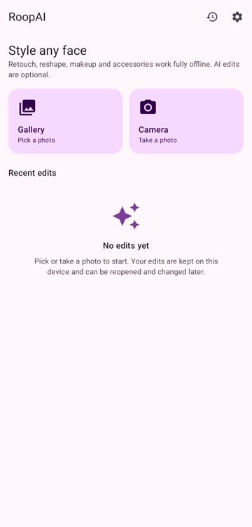
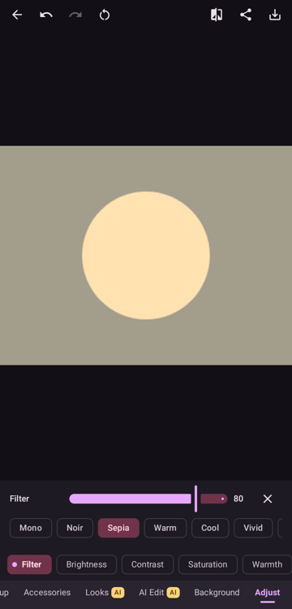
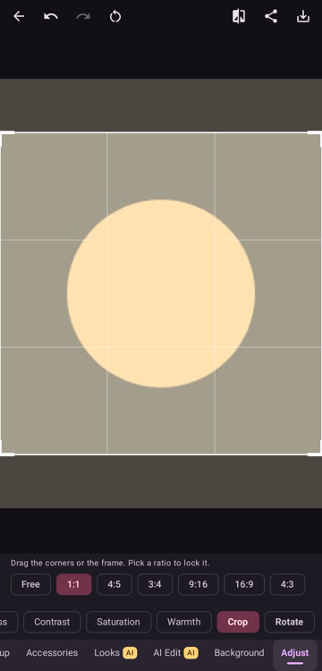
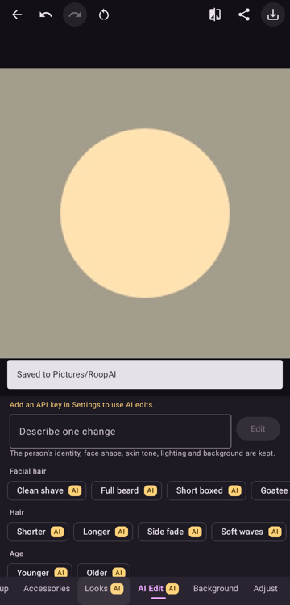
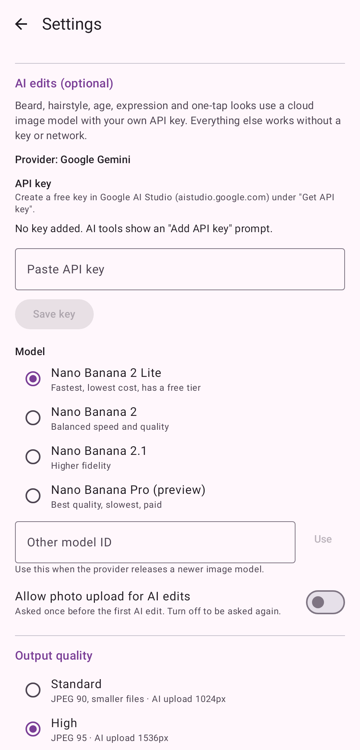

# RoopAI

A full face-styling app for Android: skin retouch, face reshape, eyes, lips, teeth, makeup, hair,
accessories, background and one-tap AI looks.

* **Works offline.** Every classic tool runs on the phone with bundled models. No account, no ads,
  no analytics, no watermark.
* **AI edits are optional.** Beard, hairstyle, age, expression and complete looks use a cloud image
  model with *your own* API key. Without a key the app is fully usable and those tools show an
  "Add API key" prompt.
* **Non-destructive.** The original photo is never changed. Edits are a list of steps you can undo,
  redo, reopen later from History and change again.

## Get the app

1. Open the [latest release](../../releases/latest).
2. Download `RoopAI-v1.0.<n>.apk` and open it on an Android 8.0+ phone.
3. Allow "install unknown apps" for your browser or file manager when asked.

The APK is debug-signed by CI. If you installed an older build and the update is refused, uninstall
the old one first (the signing key differs between CI runs).

## Screenshots

| Home | Editor | Crop | AI edits | Settings |
|---|---|---|---|---|
|  |  |  |  |  |

Screenshots are produced by the automated UI tests with a synthetic picture; replace them with
photos of your own device if you like.

## Features

Legend: **Local** = on-device, offline. **Cloud** = needs your API key (badged "AI" in the app).

| Category | Tools | Engine |
|---|---|---|
| Skin | Smoothing, blemish reduction, tone evening, dark-circle reduction, wrinkle softening | Local |
| Face | Slim, jaw, chin, forehead, nose width | Local |
| Face | Younger, older, smile, neutral, slight head turn | Cloud |
| Eyes | Brighten, eye size, eyebrow thickness, eyebrow arch, eyebrow colour | Local |
| Lips | Lip fullness, teeth whitening, lipstick | Local |
| Hair | Colour tint | Local |
| Hair | Hairstyle (fade, waves, bun, curls, straight), shorter, longer, recolour, highlights, hairline, volume, grey coverage, bald preview | Cloud |
| Facial Hair | Clean shave, full beard, short boxed beard, goatee, moustache only, twirled moustache, stubble | Cloud |
| Makeup | Foundation, blush, eyeliner, kajal, eyeshadow, lipstick, each with colour picker and intensity | Local |
| Accessories | Bindi, earrings, nose pin, glasses, cap (styles, colour, size) | Local |
| Accessories | Add glasses, remove glasses, turban / pagdi, jewellery set | Cloud |
| Looks | Wedding, office, party, festive, passport photo | Cloud |
| AI Edit | All presets in one grid plus a free-text edit | Cloud |
| Background | Blur, replace with colour, gradient, studio backdrop or your own photo | Local |
| Adjust | 10 filters, brightness, contrast, saturation, warmth, crop with ratios, rotate, flip, straighten | Local |

Editor: live preview, intensity slider for every tool, press-and-hold compare with the original,
undo / redo, reset, pinch zoom, face picker when a photo has several faces, save to
`Pictures/RoopAI`, share sheet. You can also send a photo to RoopAI from any gallery app
("Share" or "Open with").

## Add an API key (optional)

1. Create a key in [Google AI Studio](https://aistudio.google.com/) ("Get API key"). The default
   model, `gemini-3.1-flash-lite-image`, has a free tier.
2. In RoopAI open **Settings**, paste the key, tap **Save key**, then **Test key**.
3. Pick a model if you want a different speed / quality trade-off, or type any other model ID.
4. The first AI edit asks once for permission to upload the photo.

The key is encrypted with a key held in the Android Keystore and never leaves the device except in
requests to the provider you chose. It is not in this repository, in logs or in backups.

## Privacy

* Local tools never use the network. The `INTERNET` permission is used only by the cloud engine.
* For an AI edit, the current photo and a text instruction go from the phone directly to the
  provider, under your key and that provider's terms. There is no RoopAI server.
* Photos you open are copied into the app's private storage so edits can be reopened; delete them
  in History or with Settings > Clear history.

## Build from source

```
export ANDROID_HOME=/path/to/android-sdk      # platform android-37.2, build-tools 36+
./gradlew lint testDebugUnitTest assembleDebug
```

Requires JDK 17+. Output: `app/build/outputs/apk/debug/app-debug.apk`. Every push to `main` runs the
same command in GitHub Actions and publishes a release `v1.0.<run number>` with the APK.

See [CLAUDE.md](CLAUDE.md) for architecture, [DECISIONS.md](DECISIONS.md) for design decisions and
known limitations, and [RESEARCH.md](RESEARCH.md) for the feature and version research.

## Licences

App code: all rights reserved by the repository owner unless a licence file is added.
Bundled models (`face_landmarker.task`, `selfie_multiclass_256x256.tflite`) are Google MediaPipe
models under Apache 2.0. `ui/icons/AppIcons.kt` contains Material icons copied from AndroidX
(Apache 2.0).
